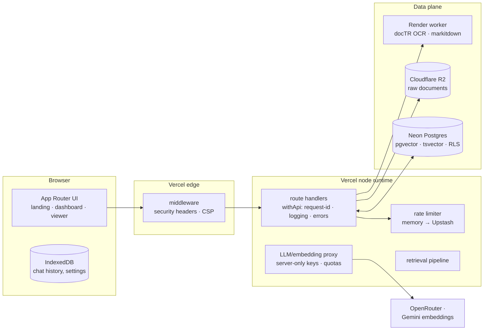
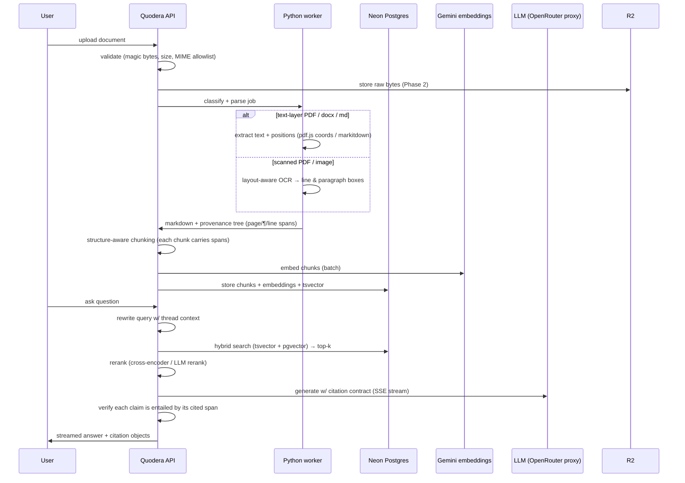
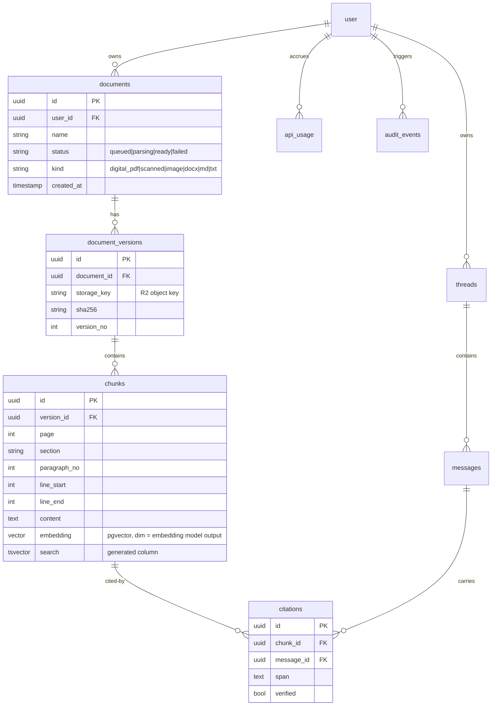

# Architecture

Status: **Phase 1 complete** (foundation). Sections marked 📍 are designed and decided (see docs/adr/) but not yet built; their phase is noted.

## 1. System context

One Next.js application (App Router) deployed on Vercel, one Postgres (Neon, pgvector) for all relational + vector data, Cloudflare R2 for raw uploads 📍, a Python OCR worker on Render 📍, and external AI providers via a server-only proxy.



## 2. The answer pipeline 📍 (Phases 3–5)

The core loop: upload → provenance-stamped chunks → hybrid retrieval → cited, verified answers.



Key decisions baked into this pipeline:

- **OCR is chosen for citation quality, not just text extraction.** docTR/PaddleOCR return line and paragraph bounding boxes — those boxes are _where page/paragraph/line citations come from_ (ADR 0005).
- **Chunking happens with the provenance tree in hand.** A chunk is worthless to this product unless it carries `{page, paragraph, lineRange, span}` minted at ingest time — retrofitting citations after retrieval is how everyone else does it, and it's why their citations are vague.
- **The model never sees whole documents or images.** Retrieval selects top-k chunk texts; that is the token-saving strategy (not "OCR to shrink tokens" — OCR is what makes images searchable at all).
- **Tables** are extracted as markdown rows and cited at table+page granularity in v1; cell-level spans are a post-v1 refinement (ADR 0006).

## 3. Citation schema 📍 (ADR 0006)

Every generated sentence must reference its evidence:

```ts
interface Citation {
  documentId: string; // document uuid (RLS-scoped)
  documentName: string; // for display
  page?: number; // PDFs & OCR'd docs (docx/html have no pages)
  section?: string; // nearest heading, when the parser found one
  paragraph: number; // always present
  lineStart?: number; // OCR'd/positional sources
  lineEnd?: number;
  span: string; // the exact source text supporting the claim
  quoteVerified: boolean; // set by the post-generation verifier
}
```

Per-format guarantees (enforced by the parser contract, tested in evals):

| Source format             | page               | paragraph       | lines          | section                |
| ------------------------- | ------------------ | --------------- | -------------- | ---------------------- |
| Digital PDF               | ✅ pdf.js coords   | ✅              | ✅ (derived)   | ✅ (nearest heading)   |
| Scanned PDF / image (OCR) | ✅ docTR page      | ✅ box grouping | ✅ box indices | ⚠️ heuristik           |
| DOCX / PPTX / HTML        | ❌ (no pagination) | ✅              | ❌             | ✅                     |
| TXT / MD                  | ❌                 | ✅              | ✅             | ✅ (markdown headings) |

The UI degrades gracefully: a citation without page numbers renders `¶ 4` instead of `p. 3, ¶ 4, l. 5–7`. Clicking any citation opens the source viewer (pdf.js) and highlights the span.

## 4. Tenancy model (shipped in Phase 1)

One database, one schema; every tenant-owned row carries `user_id`, and **Postgres RLS is the enforcement layer** — not just the ORM (ADR 0008).

```
-- per transaction:
SELECT set_config('app.user_id', $userId, true);   -- dies with the tx
-- policy (migrations/hardening/0001_tenancy_hardening.sql):
USING      (user_id = current_setting('app.user_id', true)::uuid)
WITH CHECK (user_id = current_setting('app.user_id', true)::uuid)
```

- `ENABLE` + `FORCE ROW LEVEL SECURITY` — FORCE because the app connects as the table owner (Neon branch owner), and owners bypass RLS unless forced. `rls.test.ts` proves the owner sees zero rows without context.
- Default-deny: `current_setting(..., true)` returns NULL when unset; `user_id = NULL` filters everything. No tenant context → no rows. Ever.
- `withUser(userId, fn)` (src/server/db/rls.ts) is the only sanctioned entry point — it opens the transaction and sets the context atomically.
- Belt and braces: RLS sits _under_ the application layer. A future bug in query building still cannot cross tenants, because the database itself refuses.
- **Two roles, two powers** (learned the hard way — see ADR 0008 postscript): the app connects as the unprivileged `quodera_app` role (`DATABASE_URL`); migrations and fixtures use the admin role (`DATABASE_ADMIN_URL`). Superusers bypass RLS categorically, so the runtime role must never be one — the tenancy tests connect as the runtime role and would catch a regression to a privileged connection.
- Guests are ordinary tenants (ADR 0009): a guest is a `users` row flagged `isAnonymous`, nothing more. No RLS carve-out exists anywhere in the system — a deliberate selection criterion for the guest design.

## 5. Access model 📍 (Phase 2 — ADR 0009)

| State                                | Can do                                                                       | Cannot do                                          |
| ------------------------------------ | ---------------------------------------------------------------------------- | -------------------------------------------------- |
| anonymous                            | marketing pages, status endpoints                                            | anything in `(app)`                                |
| guest (one click, no PII, no signup) | capped workspace: 2 docs (≤10 pages, ≤5 MB each), chat 5 msgs/day, citations | cloud sync, BYO persistence, caps above guest tier |
| registered                           | full workspace, sync toggle, BYO key                                         | —                                                  |

Transitions: **"Try as guest"** mints a ghost `users` row (`isAnonymous`) plus a standard session — creation is IP-capped (3/day per IP). Registering links the **same `user_id`**, so trial documents and threads carry over. Guest sessions expire after 24h; guest data is purged ≤48h by a daily Vercel cron (`/api/cron/purge-guests`, `CRON_SECRET`-guarded, admin connection) with a lazy sweep on guest creation as backstop.

Enforcement is server-side in every handler (a three-state session check), never UI-only. Guests get no special tenancy treatment — `withUser()` and RLS behave identically for them.

## 6. Data model draft 📍 (Phase 2 — ERD)

**System tables vs tenant tables.** better-auth's identity tables (`user`, `session`, `account`, `verification` — shipped in Phase 2.1) are **system tables**: they carry no user-scoped RLS, because session resolution looks up by token _before any tenant context exists_ — chicken-and-egg with `withUser`. They are written only by better-auth's parameterized queries on the runtime role. Everything downstream of a `user_id` FK is **tenant data** and copies the canary pattern (GUARDRAILS #2). Deletion cascades ride on FK constraints, which is what the guest purge (ADR 0009) will lean on.



Every table above copies the canary pattern: `user_id NOT NULL` + RLS + FORCE + policies + tenancy tests (GUARDRAILS #2).

## 7. Retrieval design 📍 (Phase 4)

- **Hybrid first, always.** Dense vectors are weak on exact identifiers (clause numbers, defined terms, names — the bread and butter of legal docs). Every query runs tsvector (exact/BM25-ish) and pgvector (cosine, HNSW) together; results are fused (RRF).
- **Rerank** the fused top-k (cross-encoder or LLM-judge) before generation; only rerank winners enter the context window.
- **Conversational rewriting:** follow-ups like "what about page 3?" are rewritten against thread history before retrieval.
- **Refusal is a feature:** when fused scores are below threshold, the assistant answers "the documents don't cover this" instead of hallucinating. Evaluated in the golden set (Phase 6).

## 8. Rate limiting

Two layers, one HTTP contract (src/server/rate-limit/):

| Layer                                                             | Driver                   | Scope                      | Phase |
| ----------------------------------------------------------------- | ------------------------ | -------------------------- | ----- |
| Limiter interface + 429 contract (`retry-after`, `x-ratelimit-*`) | —                        | all routes                 | ✅ 1  |
| Per-instance sliding window                                       | in-memory                | demo-limited               | ✅ 1  |
| Auth-route abuse guard                                            | Upstash Redis (free)     | /api/auth/\* — 10/h per IP | 2     |
| Guest-session creation cap                                        | Upstash Redis (free)     | 3/day per IP (ADR 0009)    | 2     |
| Global per-user/IP quotas (incl. guest tiers)                     | Upstash Redis (free)     | all public routes          | 2     |
| LLM spend caps (demo pool 5 msgs/day, BYO unlimited)              | proxy counters + Upstash | /api/chat                  | 4     |

The in-memory driver is **per serverless instance** — fine for proving the contract, wrong for real quotas; that's why the interface exists (ADR 0007). Guest quotas (ADR 0009): chat 5 msgs/day, uploads 2 documents (≤10 pages, ≤5 MB) with 3 uploads/hour — all constants live in one module, never scattered literals.

## 9. Runtimes (a trap we've defused)

| Runtime                                  | Runs          | Can use                   | Cannot use                                     |
| ---------------------------------------- | ------------- | ------------------------- | ---------------------------------------------- |
| Edge (middleware)                        | every request | fetch, headers, WebCrypto | pino, postgres, AsyncLocalStorage, Node stdlib |
| Node (route handlers, server components) | per request   | everything                | —                                              |

Request IDs therefore originate in `withApi` (Node), not middleware. The future edge-side limiter must be Upstash's fetch-based API — the abstraction already assumes this.

## 10. Observability

- **Structured logs** (pino): `requestId`, `route`, `status`, `durationMs` on every request; secrets redacted by path (tested in logger.test.ts).
- **Error tracking** (Sentry): initialized only when `SENTRY_DSN` is set — local dev and hermetic builds never depend on it. `onRequestError` + `global-error.tsx` cover both server and client.
- **Probes:** `/api/health` (liveness — zero dependencies), `/api/ready` (readiness — pings DB, 503 when degraded). BetterStack pings health hourly; deploy-smoke.yml asserts it after deploys.
- **Guest purge cron 📍 (Phase 2):** daily Vercel cron hits `/api/cron/purge-guests` (verified by `CRON_SECRET`, runs on the admin connection, cascade-deletes expired guest data R2 → chunks → documents → threads → audit).

## 11. Failure modes we design around

| Failure                               | Behavior                                                                                                        |
| ------------------------------------- | --------------------------------------------------------------------------------------------------------------- |
| Neon autosuspend cold start (~500 ms) | pooler URL + `connect_timeout`; ready probe reports latency                                                     |
| Free OpenRouter daily pool exhausted  | 429 with clear copy + BYO-key upsell (Phase 4)                                                                  |
| OCR worker cold start (Render free)   | job queue with status polling; document shows `queued → parsing → ready` (Phase 5)                              |
| LLM hallucinated a citation           | post-generation verifier re-checks span entailment; unverified citations are flagged in UI (Phase 4)            |
| Prompt injection inside a document    | chunks are data, never instructions: system prompt isolation + output filtering (SECURITY.md §prompt-injection) |
| Region-local limiter drift            | contract tests + Upstash migration (Phase 2)                                                                    |
| Guest farming via VPN                 | IP-capped creation + TTL purge; residual risk accepted (ADR 0009)                                               |

## 12. Phasing

1. ✅ Foundation — scaffold, CI/CD, tenancy canary, observability, limiter contract
2. Auth (better-auth: OAuth + magic links + guest ghost accounts, ADR 0009), domain schema, Upstash quotas incl. guest tiers, hardened uploads with guest caps, three-state gating
3. Ingest: parsing, chunking w/ provenance, embeddings, indexing
4. Retrieval + cited generation + SSE + LLM proxy
5. OCR worker + scanned/image pipeline + tables
6. Evals in CI, security hardening, audit log
7. Ship: demo, landing copy, CV
