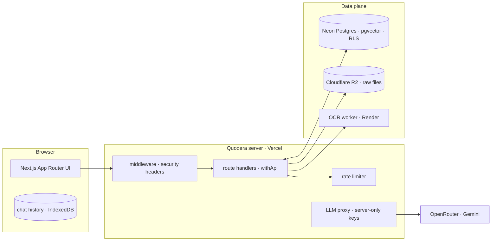

# Quodera<sup>1</sup>

**Answers, demonstrated.**

[](https://github.com/tasaufmim/quodera/actions/workflows/ci.yml)
[](LICENSE)

Quodera is a **citation-grounded RAG platform**. Upload lecture sheets, legal contracts, book chapters, or official documents; ask questions; get answers where **every sentence cites its exact source** — document, page, paragraph, and line — not just "relevant links" at the end.

```jsonc
// Every generated sentence carries a citation object like this:
{
  "text": "The notice period is 30 days for month-to-month tenancies.",
  "citations": [
    {
      "document": "lease-agreement.pdf",
      "page": 4,
      "paragraph": 2,
      "lines": [3, 6],
      "span": "…the tenant shall provide thirty (30) days written notice…",
    },
  ],
}
```

<sub>1 — _quod erat demonstrandum_ ("thus it was demonstrated"). The name is the spec: no claim without proof.</sub>

**One-click guest trial (Phase 2):** try the full workspace as a guest — no signup, no email — with capped uploads and chat. Register later and your trial documents carry over. Temporary by design: guest data is deleted within 48 hours.

---

## Status

Portfolio-grade build, in progress. Phase 1 (foundation) is complete and deployed.

| Phase | Scope                                                                                                                    | Status                       |
| ----- | ------------------------------------------------------------------------------------------------------------------------ | ---------------------------- |
| 1     | Foundation: scaffold, governance docs, CI/CD, RLS tenancy canary, observability, rate-limit contract                     | ✅ done                      |
| 2     | Auth (better-auth: OAuth + magic links), one-click guest trial (ADR 0009), real schema, Upstash quotas, hardened uploads | 🔨 2.1–2.6 merged · 2.7 next |
| 3     | Ingest: parsing, structure-aware chunking with provenance, Gemini embeddings, pgvector indexing                          | ⬜                           |
| 4     | Retrieval & chat: hybrid BM25+vector, rerank, cited generation, SSE streaming, BYO-key LLM proxy                         | ⬜                           |
| 5     | OCR worker (layout-aware, line boxes), scanned PDFs & images, tables                                                     | ⬜                           |
| 6     | Evals (golden set, citation precision) in CI, security hardening, audit log                                              | ⬜                           |
| 7     | Ship: demo assets, landing page, CV                                                                                      | ⬜                           |

## Architecture (one diagram)



Full pipeline, tenancy model, citation schema, and failure modes: [ARCHITECTURE.md](ARCHITECTURE.md).

## Quickstart

Prerequisites: **Node 24+**, **pnpm**, **Docker** (for the local Postgres + pgvector).

```bash
git clone https://github.com/tasaufmim/quodera
cd quodera
pnpm install

cp .env.example .env     # local defaults already point at the Docker DB
pnpm db:up               # Postgres 17 + pgvector on localhost:5433
pnpm db:migrate          # applies generated + RLS hardening migrations

pnpm dev                 # http://localhost:3000
```

Prove everything (typecheck, lint, unit + RLS tenancy tests, production build, optional HTTP smoke):

```bash
pnpm verify:phase1
SMOKE=1 pnpm verify:phase1   # also boots the build and probes the HTTP contract
```

## Scripts

| Command                              | What it does                                                          |
| ------------------------------------ | --------------------------------------------------------------------- |
| `pnpm dev` / `build` / `start`       | develop / build / serve the production build                          |
| `pnpm typecheck` / `lint` / `format` | `tsc --noEmit` / ESLint / Prettier                                    |
| `pnpm test`                          | unit tests (Vitest) — db tests skip when no DB is up                  |
| `pnpm test:db`                       | RLS tenancy tests against a real Postgres                             |
| `pnpm test:e2e`                      | Playwright smoke against the production build                         |
| `pnpm db:generate`                   | generate a SQL migration from `src/server/db/schema.ts` (drizzle-kit) |
| `pnpm db:migrate`                    | apply all migrations (generated + hand-written hardening)             |
| `pnpm db:up` / `db:down`             | start/stop the local Docker Postgres                                  |
| `pnpm verify:phase1`                 | the phase's definition of done, as code                               |

## Project layout

```
src/
  app/                    # routes — (marketing) and (app) groups, /api handlers
  server/                 # server-only code. NEVER imported from client components
    db/                   # drizzle client, schema, withUser (RLS), migrations/
    lib/                  # env validation, logger, withApi, request context
    rate-limit/           # limiter contract + memory driver + 429 helpers
  middleware.ts           # edge: security headers (no Node APIs here)
e2e/                      # Playwright smoke tests
scripts/                  # apply-migrations, verify-phase1
docs/
  adr/                    # architecture decision records (start with template.md)
  ops/PROVISIONING.md     # every account, secret, and setup step
migrations/hardening/     # hand-written RLS/policy/index SQL (see docs)
```

## Documentation

| Doc                                                    | Purpose                                                          |
| ------------------------------------------------------ | ---------------------------------------------------------------- |
| [ARCHITECTURE.md](ARCHITECTURE.md)                     | system design, pipeline, tenancy, citation schema, failure modes |
| [SECURITY.md](SECURITY.md)                             | threat model, key proxy, rate-limit matrix, hardening checklist  |
| [AGENTS.md](AGENTS.md)                                 | how AI coding agents must operate in this repo                   |
| [docs/GUARDRAILS.md](docs/GUARDRAILS.md)               | the ten invariants every change must respect                     |
| [docs/CODING_GUIDELINES.md](docs/CODING_GUIDELINES.md) | style, structure, testing rules                                  |
| [docs/ops/PROVISIONING.md](docs/ops/PROVISIONING.md)   | accounts, secrets, deploy wiring                                 |
| [docs/adr/](docs/adr/)                                 | why every major decision was made                                |

## Deployment

Free-tier by design (see ADR 0001): **Vercel** (app) · **Neon** (Postgres + pgvector) · **Cloudflare R2** (raw files) · **Render** (OCR worker, Phase 5) · **Upstash** (Redis quotas, Phase 2). Setup steps: [docs/ops/PROVISIONING.md](docs/ops/PROVISIONING.md).

## License

[MIT](LICENSE)
